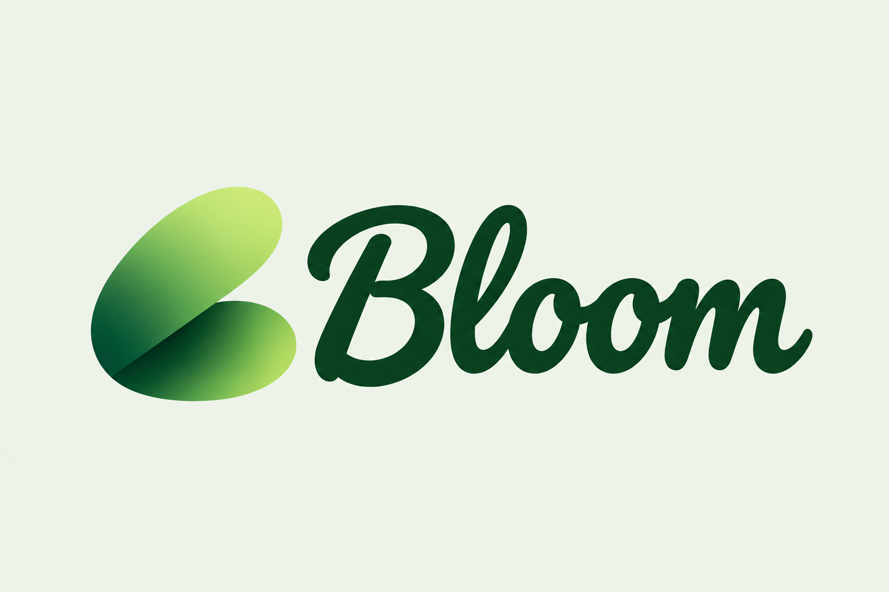
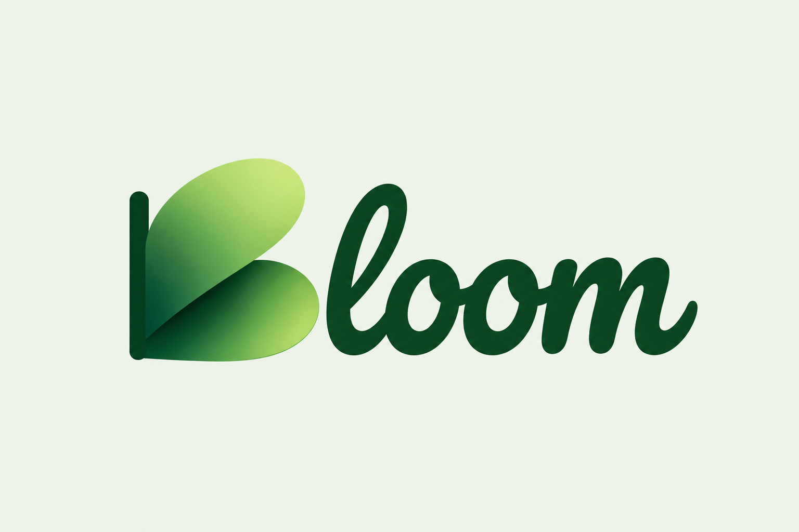
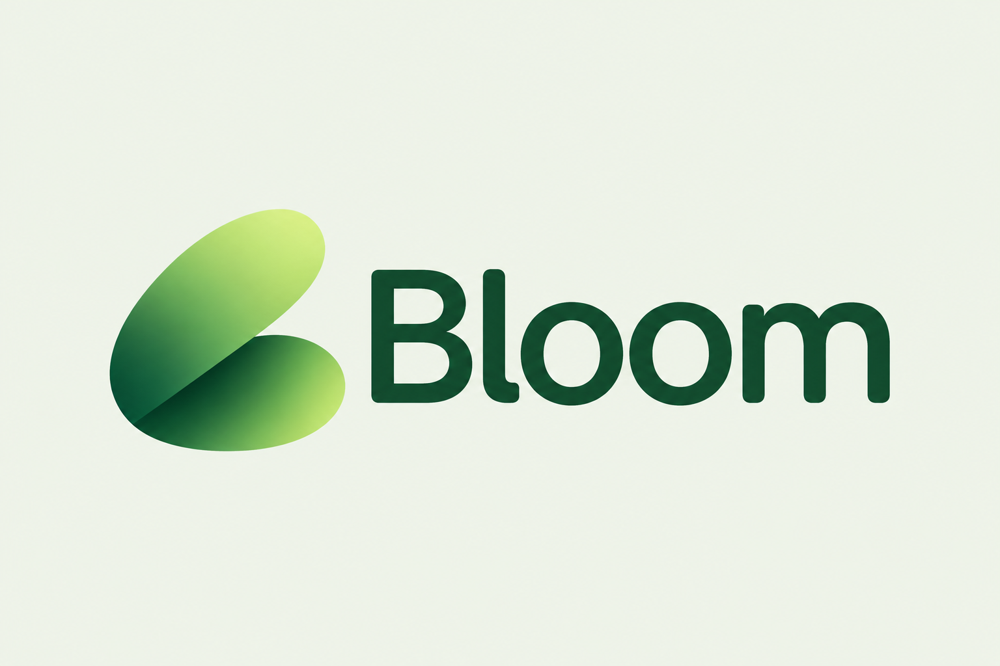
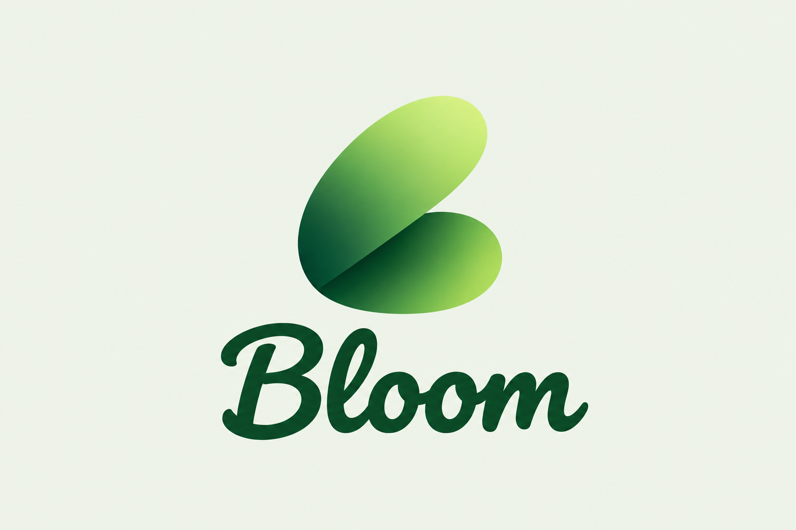
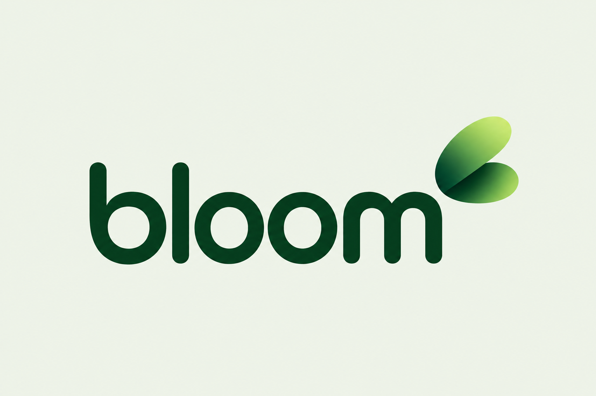

# Bloom · пять концептов логотипа

4 ноября 2026. Созданы ImageGen на основе оригинальной эмблемы. Это отдельные растровые концепты, не финальные векторные мастера. Логотип и Pacifico на сайте не изменены.

## 1. Знак + полное рукописное Bloom

## 2. Знак с вертикальным штрихом как B

## 3. Знак + полное Bloom гротеском

## 4. Вертикальная композиция

## 5. Строчное bloom и отдельный знак

Предпочтение дизайнера:1 сохраняет рукописный характер и полностью решает чтение B;3 даёт наиболее ясное чтение на маленьком размере.2 ближе к текущей композиции, но требует аккуратной ручной векторной доработки.
